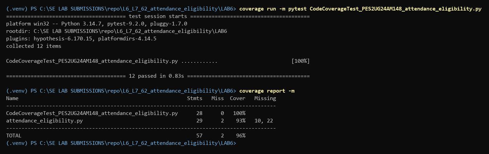
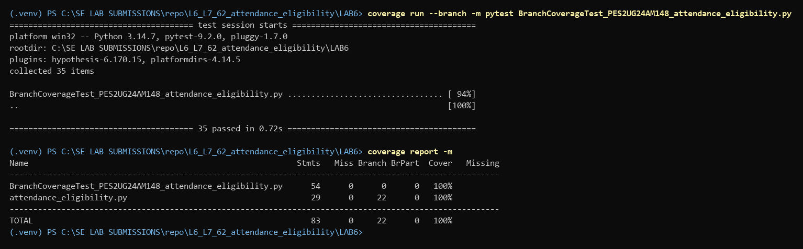

# Lab 6: Code and Branch Coverage Analysis

**Name:** Satwik Subramanya  
**SRN:** PES2UG24AM148  
**Section:** AIML 5B  
**Module under test:** `attendance_eligibility.py` (29 statements, 22 branches)

## Summary

Figures are for `attendance_eligibility.py` only, taken from `coverage report -m`.

| Stage | Tests | Line coverage | Coverage with `--branch` | Partial branches | Missing lines |
|-------|-------|---------------|--------------------------|------------------|---------------|
| Starter test file (2 tests) | 2 | 41% | 35% | 6 | 3, 5, 7, 10, 16, 19–23, 27–33 |
| Code coverage tests | 12 | 93% | 92% | 2 | 10, 22 |
| Branch coverage tests | 35 | 100% | 100% | 0 | none |

## Files

| File | Purpose |
|------|---------|
| `CodeCoverageTest_PES2UG24AM148_attendance_eligibility.py` | Test cases for code (line) coverage |
| `BranchCoverageTest_PES2UG24AM148_attendance_eligibility.py` | Test cases for branch coverage |
| `test_attendance_eligibility.py` | The starter test file, extended; same content as the branch coverage file |
| `screenshots/CodeCoverage_Screenshot.png` | Terminal output of the code coverage run |
| `screenshots/BranchCoverage_Screenshot.png` | Terminal output of the branch coverage run |

## Commands

```bash
# code coverage
coverage run -m pytest CodeCoverageTest_PES2UG24AM148_attendance_eligibility.py
coverage report -m

# branch coverage
coverage run --branch -m pytest BranchCoverageTest_PES2UG24AM148_attendance_eligibility.py
coverage report -m
```

## Code coverage analysis

The two starter tests only followed the "everything is fine" path: a valid attendance figure and a student above 75% with fees paid. Seventeen of 29 statements never ran, including both `raise` statements and the whole of `attendance_warning`.

I added one test for each distinct outcome of each function:

- `attendance_percent`: invalid total, attended more than total, medical leave above the 5-day cap.
- `exam_eligibility`: fees pending, eligible through condonation, detained.
- `attendance_warning`: no warning, reminder, critical, final notice.

That took line coverage to 93% (27 of 29 statements).



## Branch coverage analysis

Running the same 12 tests with `--branch` showed two partial branches, at the two lines still missing:

| Line | Condition | Direction never taken | Test added |
|------|-----------|-----------------------|------------|
| 9 | `if credited > total_classes` | True (attendance plus leave exceeds classes held) | `attendance_percent(38, 40, 5) == 100` |
| 20 | `if has_condonation` | False (65–74% without condonation) | `exam_eligibility(70, False, True) == "condonation required"` |

With those two tests every branch is taken in both directions: 22 of 22, with 0 partial.



## Tests added beyond what the tool asked for

Coverage reaching 100% does not mean the tests are complete, so the branch coverage file also checks things the report cannot see:

- **Both halves of the `or` on line 4.** `attended < 0 or attended > total_classes` counts as covered as soon as either half is true. The first set of tests only used `attended > total`. I added `attended = -1` so each half is tested on its own. Branch coverage is not condition coverage.
- **Boundary values.** Every comparison is tested at the boundary and one step either side: 75/74 and 65/64 for eligibility, 85/84 and 75/74 for warnings, exactly 4 weeks left against 5, and medical leave of 4, 5 and 6 days. A mistake such as `>` written as `>=` would still give 100% coverage with values far from the boundary, and only these tests would catch it.
- **Order of checks.** Fees pending is returned even when attendance is 40%, which confirms the fee check comes first.
- **Rounding.** `attendance_percent(2, 3, 0)` is 66, not 67, because the function uses floor division.

## Observation about the module

Coverage only measures the code that exists. `attendance_percent` does not reject a negative `medical_leave_days`: `attendance_percent(30, 40, -10)` returns 50 instead of raising an error. No line or branch is missing for that case because there is no code for it, so the report stays at 100%. I left the module unchanged since the lab is about testing it, but it is a reminder that full coverage is not proof of correctness.
